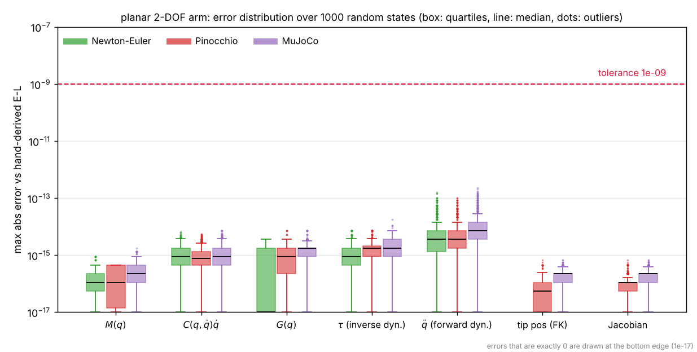
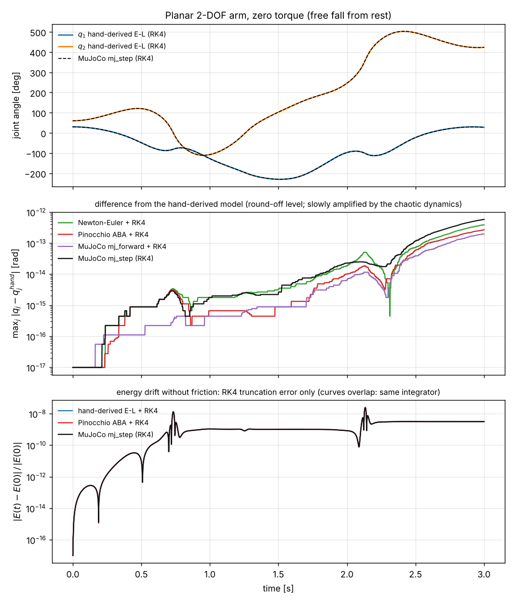
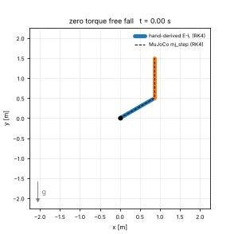

# planar-2dof: 동역학 교차 검증

평면 2DOF 팔(수직 평면)의 동역학 `M(q) q̈ + C(q,q̇) q̇ + G(q) = τ` 를 네 가지 방법으로 계산해 서로 비교합니다.

| 방법 | 내용 |
|---|---|
| hand | 손으로 유도한 오일러-라그랑주 최종식 |
| NE | 뉴턴-오일러 재귀 (힘과 모멘트 평형) |
| Pinocchio | `models/planar-2dof/planar_2dof.urdf` 를 읽어 CRBA, RNEA, ABA 로 계산 |
| MuJoCo | `models/planar-2dof/planar_2dof.xml` 을 읽어 `mj_fullM`, `mj_inverse`, `mj_forward` 로 계산 |

파라미터는 `models/planar-2dof/params.yaml` 이 단일 출처입니다. URDF 와 MJCF 가 이 값과 어긋나면 비교가 FAIL 로 끝납니다.

## 설치

Python 3.10 이상. 패키지: `numpy`, `pyyaml`, `pin`(Pinocchio), `mujoco`, 선택 `sympy`, 시각화용 `matplotlib`.

```bash
# Linux, WSL2 (pip 로 모두 설치 가능)
pip install numpy pyyaml pin mujoco sympy matplotlib

# Windows: pin 의 pip 설치는 지원되지 않으므로 conda-forge 를 사용
conda create -n robotics python=3.12
conda activate robotics
conda install -c conda-forge pinocchio numpy pyyaml matplotlib
pip install mujoco sympy
```

## 실행

```bash
python experiments/planar-2dof/dynamics_compare_2dof.py            # 네 가지 방법 비교 + 성질 검사
python experiments/planar-2dof/dynamics_compare_2dof.py --sympy    # 라그랑지안에서 sympy 로 재유도해 비교
python experiments/planar-2dof/dynamics_compare_2dof.py --lyapunov # PD + 중력 보상의 V(t) 수치 확인
```

모든 항목이 `OK` 이면 종료 코드 0, 하나라도 `NG` 이면 1 입니다.

| 옵션 | 용도 |
|---|---|
| `--i1-coeff 0.5` | 손 유도 M11 의 I1 계수를 예전 오류(1/2)로 두어 FAIL 이 나는지 확인 |
| `--m1 --m2 --l1 --l2 --I1 --I2 --g` | 파라미터를 바꿔 비교 (이때는 파일 대신 내장 생성기의 모델을 사용) |
| `--n-random N`, `--tol T`, `--seed S` | 무작위 상태 개수(기본 1000), 허용 오차(기본 1e-9), 시드 |
| `--write-models DIR` | 현재 파라미터로 URDF, MJCF 를 DIR 에 생성 (`models/planar-2dof` 갱신용) |
| `--embedded` | 모델 파일을 읽지 않고 내장 생성기 모델로 비교 |
| `--view` | MuJoCo 뷰어 (화면이 있는 PC 필요) |

## 결과 (기본 파라미터, 무작위 상태 1000개, hand 대비 최대 오차)

| 양 | NE | Pinocchio | MuJoCo |
|---|---|---|---|
| M(q) | 8.9e-16 | 4.4e-16 | 1.8e-15 |
| C q̇ | 6.7e-15 | 5.4e-15 | 7.2e-15 |
| G | 3.6e-15 | 7.1e-15 | 7.1e-15 |
| 역동역학 τ | 7.1e-15 | 7.1e-15 | 1.8e-14 |
| 순동역학 q̈ | 1.6e-13 | 1.0e-13 | 2.3e-13 |

## 시각화

```bash
python experiments/planar-2dof/visualize_2dof.py            # 그림 2장 + GIF 를 figures/ 에 생성 (클라우드에서 17초)
python experiments/planar-2dof/visualize_2dof.py --T 5 --q0 30 60 --no-gif
```

| 옵션 | 용도 |
|---|---|
| `--T`, `--dt`, `--q0 Q1 Q2` | 자유낙하 시간 [s], 적분 시간 간격 [s], 초기 관절각 [deg] (기본 3 s, 1e-3 s, 30°/60°) |
| `--n-random N`, `--seed S`, `--tol T` | 오차 분포에 쓸 무작위 상태 개수(기본 1000), 시드, 합격 기준 |
| `--out-dir DIR`, `--models-dir DIR`, `--no-gif` | 저장 폴더, 모델 폴더, GIF 생략 |

그림의 글자는 어떤 PC에서 만들어도 같게 나오도록 영어로 씁니다.

### 1. 오차 분포: 손 유도 대비 최대 오차



무작위 상태 1000개에서 양(M, C q̇, G, 역동역학, 순동역학, FK, Jacobian)별 오차가 모두 합격 기준(1e-9)보다 4자릿수 이상 아래에 있습니다 (전체 최대 2.27e-13). 막대가 바닥까지 뻗은 것은 오차가 정확히 0인 상태가 있기 때문입니다.

### 2. 토크 0 자유낙하: 네 방법 비교



초기 자세 (30°, 60°), 정지 상태에서 3초 동안 떨어뜨립니다. 모든 방법에 같은 RK4와 같은 시간 간격(1 ms)을 써서, 차이는 모델의 차이만 반영합니다.

- **궤적**: 손 유도, 뉴턴-오일러, Pinocchio, MuJoCo가 겹칩니다. hand 대비 최대 관절각 차이는 3초 동안 5.8e-13 rad 이하입니다 (MuJoCo `mj_step`(RK4)이 5.8e-13으로 가장 큼).
- **에너지**: 마찰이 없으므로 총 에너지 E = ½ q̇ᵀ M q̇ + Σ m g y 는 일정해야 합니다. 상대 변화의 최대는 2.45e-8이고 세 방법이 같습니다. 이는 모델 차이가 아니라 RK4 적분 오차(같은 적분기라 같은 값)입니다.
- **혼돈계라는 점**: 이중 진자는 작은 차이가 시간이 지나며 증폭됩니다. 두 방법이 긴 시간에서 갈라져도 모델 오류인지 이 증폭인지 구별해야 하므로, 비교는 짧은 구간(기본 3초)만 합니다.

### 3. 애니메이션



파란색과 주황색은 손 유도식을 RK4로 적분한 팔이고, 점선은 MuJoCo `mj_step`(RK4)의 팔입니다. 빨간 선은 끝단의 궤적입니다.

## 한계와 현실 적용 시 고려사항

- 무게중심이 링크 중간이고 마찰, 백래시, 탄성이 없는 이상적인 강체 모델입니다.
- 자유낙하 시각화도 같은 이상 모델이라 마찰, 백래시, 센서 노이즈, 제어 주기 지터가 없습니다. 실제 로봇과의 차이(Sim-to-Real 갭)는 포함하지 않습니다.
- 이중 진자는 혼돈계라 긴 시간의 궤적 비교는 모델 차이와 구별하기 어렵습니다. 에너지 변화(2.45e-8)는 적분기 정확도에 좌우됩니다.
- 관성이 0인 점질량은 MuJoCo 가 양수 관성을 요구해 1e-9 로 대체하므로 오차가 커집니다 (`--tol` 을 완화).
- 실제 로봇에서는 파라미터 식별 오차, 마찰, 제어 주기 지터, 센서 노이즈가 이 모델과의 차이를 만듭니다.
- 이 스크립트는 Python 검증용이며, 실시간 영역의 C++ 구현은 이 결과를 정답(회귀 시험 기준)으로 삼습니다.
