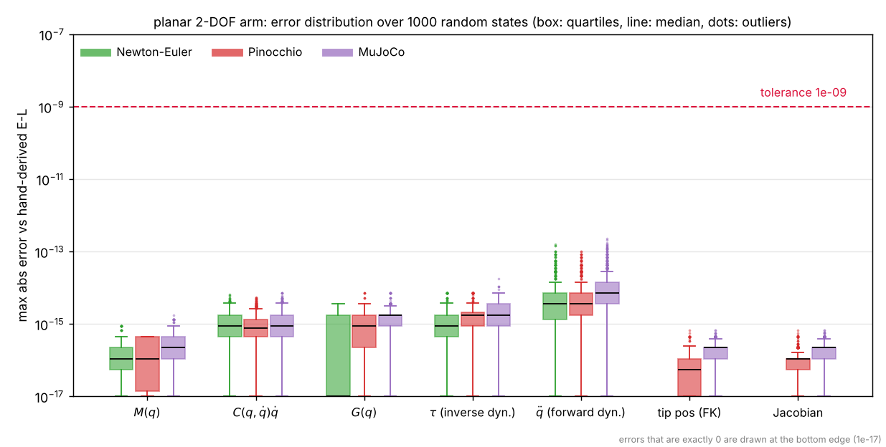
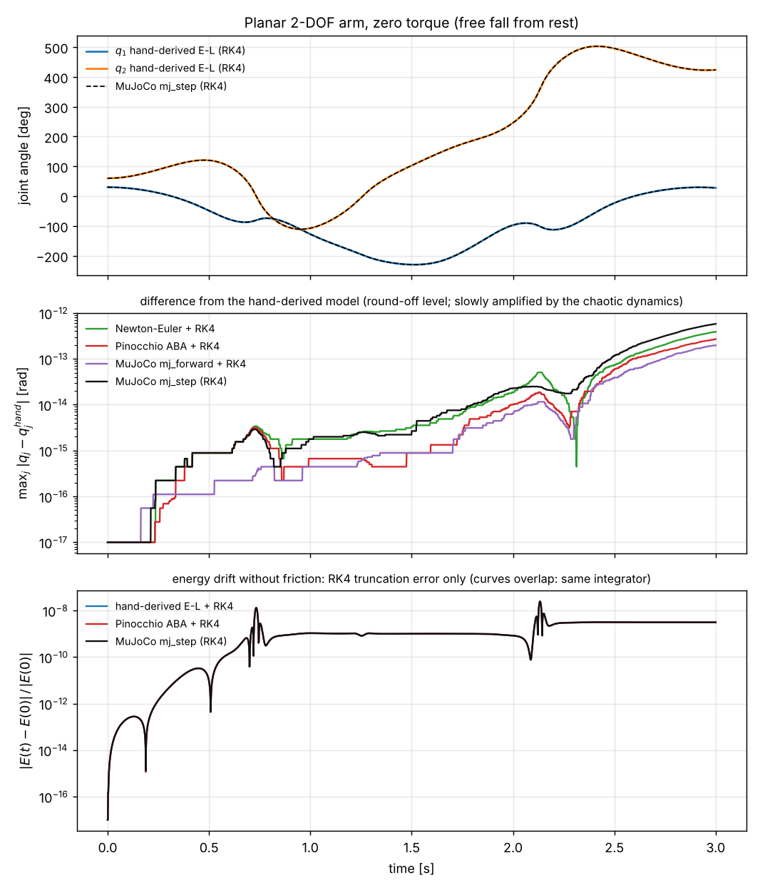
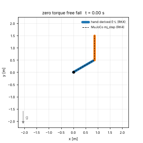
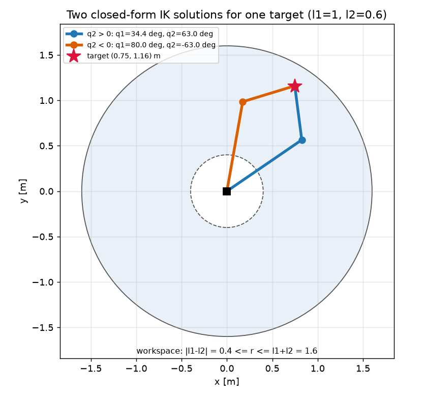
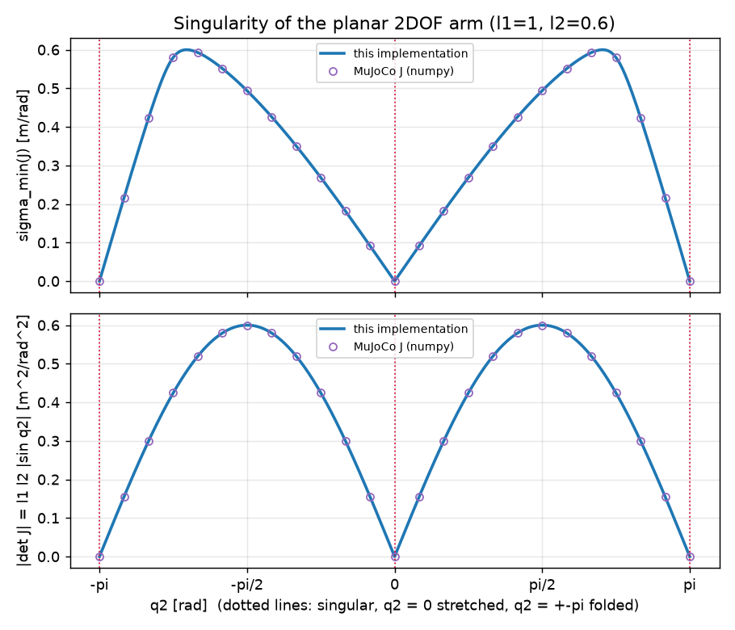

# planar-2dof: 동역학 교차 검증

평면 2DOF 팔(수직 평면)의 동역학 `M(q) q̈ + C(q,q̇) q̇ + G(q) = τ` 를 네 가지 방법으로 계산해 서로 비교합니다.

| 방법 | 내용 |
|---|---|
| hand | 손으로 유도한 오일러-라그랑주 최종식 |
| NE | 뉴턴-오일러 재귀 (힘과 모멘트 평형) |
| Pinocchio | `models/planar-2dof/planar_2dof.urdf` 를 읽어 CRBA, RNEA, ABA 로 계산 |
| MuJoCo | `models/planar-2dof/planar_2dof.xml` 을 읽어 `mj_fullM`, `mj_inverse`, `mj_forward` 로 계산 |

파라미터는 `models/planar-2dof/params.yaml` 이 단일 출처입니다. URDF 와 MJCF 가 이 값과 어긋나면 비교가 FAIL 로 끝납니다.

기구학(FK, Jacobian, 닫힌 해 IK, 특이점)은 아래 [기구학 비교](#기구학-비교) 절을 보세요.

## 설치

Python 3.10 이상. 패키지: `numpy`, `pyyaml`, `pin`(Pinocchio), `mujoco`, 선택 `sympy`, 시각화용 `matplotlib`.

```bash
# Linux, WSL2 (pip 로 모두 설치 가능)
pip install numpy pyyaml pin mujoco sympy matplotlib

# Windows: pin 의 pip 설치는 지원되지 않으므로 conda-forge 를 사용
conda create -n robotics python=3.12
conda activate robotics
conda install -c conda-forge pinocchio numpy pyyaml matplotlib
pip install mujoco sympy
```

## 실행

```bash
python experiments/planar-2dof/dynamics_compare_2dof.py            # 네 가지 방법 비교 + 성질 검사
python experiments/planar-2dof/dynamics_compare_2dof.py --sympy    # 라그랑지안에서 sympy 로 재유도해 비교
python experiments/planar-2dof/dynamics_compare_2dof.py --lyapunov # PD + 중력 보상의 V(t) 수치 확인
```

모든 항목이 `OK` 이면 종료 코드 0, 하나라도 `NG` 이면 1 입니다.

| 옵션 | 용도 |
|---|---|
| `--i1-coeff 0.5` | 손 유도 M11 의 I1 계수를 예전 오류(1/2)로 두어 FAIL 이 나는지 확인 |
| `--m1 --m2 --l1 --l2 --I1 --I2 --g` | 파라미터를 바꿔 비교 (이때는 파일 대신 내장 생성기의 모델을 사용) |
| `--n-random N`, `--tol T`, `--seed S` | 무작위 상태 개수(기본 1000), 허용 오차(기본 1e-9), 시드 |
| `--write-models DIR` | 현재 파라미터로 URDF, MJCF 를 DIR 에 생성 (`models/planar-2dof` 갱신용) |
| `--embedded` | 모델 파일을 읽지 않고 내장 생성기 모델로 비교 |
| `--view` | MuJoCo 뷰어 (화면이 있는 PC 필요) |

## 결과 (기본 파라미터, 무작위 상태 1000개, hand 대비 최대 오차)

| 양 | NE | Pinocchio | MuJoCo |
|---|---|---|---|
| M(q) | 8.9e-16 | 4.4e-16 | 1.8e-15 |
| C q̇ | 6.7e-15 | 5.4e-15 | 7.2e-15 |
| G | 3.6e-15 | 7.1e-15 | 7.1e-15 |
| 역동역학 τ | 7.1e-15 | 7.1e-15 | 1.8e-14 |
| 순동역학 q̈ | 1.6e-13 | 1.0e-13 | 2.3e-13 |

## 시각화

```bash
python experiments/planar-2dof/visualize_2dof.py            # 그림 2장 + GIF 를 figures/ 에 생성 (클라우드에서 17초)
python experiments/planar-2dof/visualize_2dof.py --T 5 --q0 30 60 --no-gif
```

| 옵션 | 용도 |
|---|---|
| `--T`, `--dt`, `--q0 Q1 Q2` | 자유낙하 시간 [s], 적분 시간 간격 [s], 초기 관절각 [deg] (기본 3 s, 1e-3 s, 30°/60°) |
| `--n-random N`, `--seed S`, `--tol T` | 오차 분포에 쓸 무작위 상태 개수(기본 1000), 시드, 합격 기준 |
| `--out-dir DIR`, `--models-dir DIR`, `--no-gif` | 저장 폴더, 모델 폴더, GIF 생략 |

그림의 글자는 어떤 PC에서 만들어도 같게 나오도록 영어로 씁니다.

### 1. 오차 분포: 손 유도 대비 최대 오차



무작위 상태 1000개에서 양(M, C q̇, G, 역동역학, 순동역학, FK, Jacobian)별 오차가 모두 합격 기준(1e-9)보다 4자릿수 이상 아래에 있습니다 (전체 최대 2.27e-13). 막대가 바닥까지 뻗은 것은 오차가 정확히 0인 상태가 있기 때문입니다.

### 2. 토크 0 자유낙하: 네 방법 비교



초기 자세 (30°, 60°), 정지 상태에서 3초 동안 떨어뜨립니다. 모든 방법에 같은 RK4와 같은 시간 간격(1 ms)을 써서, 차이는 모델의 차이만 반영합니다.

- **궤적**: 손 유도, 뉴턴-오일러, Pinocchio, MuJoCo가 겹칩니다. hand 대비 최대 관절각 차이는 3초 동안 5.8e-13 rad 이하입니다 (MuJoCo `mj_step`(RK4)이 5.8e-13으로 가장 큼).
- **에너지**: 마찰이 없으므로 총 에너지 E = ½ q̇ᵀ M q̇ + Σ m g y 는 일정해야 합니다. 상대 변화의 최대는 2.45e-8이고 세 방법이 같습니다. 이는 모델 차이가 아니라 RK4 적분 오차(같은 적분기라 같은 값)입니다.
- **혼돈계라는 점**: 이중 진자는 작은 차이가 시간이 지나며 증폭됩니다. 두 방법이 긴 시간에서 갈라져도 모델 오류인지 이 증폭인지 구별해야 하므로, 비교는 짧은 구간(기본 3초)만 합니다.

### 3. 애니메이션



파란색과 주황색은 손 유도식을 RK4로 적분한 팔이고, 점선은 MuJoCo `mj_step`(RK4)의 팔입니다. 빨간 선은 끝단의 궤적입니다.

## 한계와 현실 적용 시 고려사항

- 무게중심이 링크 중간이고 마찰, 백래시, 탄성이 없는 이상적인 강체 모델입니다.
- 자유낙하 시각화도 같은 이상 모델이라 마찰, 백래시, 센서 노이즈, 제어 주기 지터가 없습니다. 실제 로봇과의 차이(Sim-to-Real 갭)는 포함하지 않습니다.
- 이중 진자는 혼돈계라 긴 시간의 궤적 비교는 모델 차이와 구별하기 어렵습니다. 에너지 변화(2.45e-8)는 적분기 정확도에 좌우됩니다.
- 관성이 0인 점질량은 MuJoCo 가 양수 관성을 요구해 1e-9 로 대체하므로 오차가 커집니다 (`--tol` 을 완화).
- 실제 로봇에서는 파라미터 식별 오차, 마찰, 제어 주기 지터, 센서 노이즈가 이 모델과의 차이를 만듭니다.
- 이 스크립트는 Python 검증용이며, 실시간 영역의 C++ 구현은 이 결과를 정답(회귀 시험 기준)으로 삼습니다.

## 기구학 비교

손으로 유도한 FK, Jacobian, 닫힌 해 IK(해 2개), 특이점 식을 코드로 옮기고(`kinematics_compare_2dof.py`), 기존 `hand_fk`, Pinocchio, MuJoCo와 비교합니다. 이 파일의 식은 사용자 유도를 기준으로 하고, 기존 `hand_fk`는 교차 검증용으로 그대로 둡니다.

규약: x-y 평면, q1은 베이스 기준 절대각, q2는 링크1 기준 상대각 [rad], 길이 [m], J의 단위 [m/rad].

| 식 | 내용 |
|---|---|
| FK | `x = l1 cos q1 + l2 cos(q1+q2)`, `y = l1 sin q1 + l2 sin(q1+q2)` |
| det J | `l1 l2 sin q2` (q2 = 0 펴짐, q2 = ±π 접힘에서 0) |
| J⁻¹ | 수반행렬 / det J. `\|sin q2\| < 1e-6` 이면 `SingularJacobianError` |
| 위치 IK | `c2 = (x²+y²-l1²-l2²)/(2 l1 l2)`, `q2 = ±acos(c2)`, `q2>0` 이면 `q1 = φ-γ`, `q2<0` 이면 `q1 = φ+γ` |
| 도달 조건 | `\|l1-l2\| <= r <= l1+l2` |

### 실행

```bash
# Windows 는 conda 환경을 활성화한 뒤 실행합니다 (활성화하지 않고 python.exe 를 직접 부르면 numpy 선형대수 호출이 DLL 오류로 종료될 수 있습니다)
conda activate robotics

python experiments/planar-2dof/kinematics_compare_2dof.py            # 검증 A~G (기본 모델 + 비대칭 링크 패스)
python experiments/planar-2dof/kinematics_compare_2dof.py --plot     # 그림 2장을 figures/ 에 저장
python experiments/planar-2dof/kinematics_compare_2dof.py --ik-sign-flip   # q1 의 ±γ 부호를 일부러 뒤집어 FAIL 확인
```

모든 항목이 `OK` 이면 종료 코드 0, 하나라도 `NG` 이면 1 입니다. 레포 루트에서 실행하면 한 번에 재현되고, 2.6초 정도 걸립니다.

| 옵션 | 용도 |
|---|---|
| `--n-random N`, `--tol T`, `--seed S` | 무작위 상태 개수(기본 1000), 허용 오차(기본 1e-9), 시드(기본 0) |
| `--models-dir DIR`, `--embedded` | 모델 폴더, 모델 파일 대신 내장 생성기 사용 (동역학 파일과 같은 의미) |
| `--l1 L --l2 L` | 링크 길이를 직접 지정 (내장 생성기 모델을 쓰고 비대칭 패스는 생략) |
| `--plot [DIR]` | 그림 2장 저장 (기본 `figures/`) |
| `--ik-sign-flip` | 닫힌 해의 부호를 뒤집어 검증이 FAIL 을 내는지 확인 |

### 검증 항목

| | 내용 | 기준 |
|---|---|---|
| A | FK, J: 새 구현, `hand_fk`, Pinocchio, MuJoCo 쌍별 최대 오차 | tol |
| B | det J: `det_jacobian` 대 numpy det(J_pin), det(J_mj) | tol |
| C | J⁻¹: `\|\|J J⁻¹ - I\|\|`와 numpy inv(J_pin) 비교 (`\|sin q2\| > 1e-3`) | tol·max(1, cond J) |
| D | IK 왕복: MuJoCo tip → 닫힌 해 → 원래 q 복원, 두 해 모두 Pinocchio와 MuJoCo FK로 target 만족 | 각도 1e-9, FK tol |
| E | 반복 IK(DLS): 임의 시작점의 수렴 해가 닫힌 해 둘 중 하나와 일치 (수렴률은 참고) | 1e-6 rad |
| F | 도달 범위: 범위 밖 빈 목록, 경계 해 1개, 원점 처리 | 일치 |
| G | 특이점: σ_min, \|det J\|, cond, J⁻¹ 오차 표, 움직일 수 없는 방향 | tol |

링크 길이가 같으면(기본 `l1 = l2 = 1`) `l1` 과 `l2` 를 바꿔 쓴 오류가 결과를 바꾸지 않아 검증이 잡지 못합니다. 그래서 기본 실행은 비대칭 링크(`l1 = 1.0`, `l2 = 0.6`, 내장 생성기 모델)로 한 번 더 검증합니다. 실제로 FK 구현에 `l1`, `l2` 교환을 일부러 넣어 보면 기본 모델 패스는 통과하고 비대칭 패스만 5개 항목이 FAIL 로 잡혔습니다.

### 결과 (무작위 1000개, seed 0, tol 1e-9)

| 항목 | 기본 모델 (l1 = l2 = 1) | 비대칭 (l1 = 1, l2 = 0.6) |
|---|---|---|
| A. 새 구현 대 hand / Pinocchio / MuJoCo 최대 오차 (tip, J 중 큰 값) | 0 / 6.7e-16 / 7.2e-16 | 0 / 3.7e-16 / 5.0e-16 |
| B. det J 최대 오차 | 5.6e-16 | 3.3e-16 |
| C. `\|\|J J⁻¹ - I\|\|` 최대 | 2.9e-13 | 3.0e-13 |
| D. 원래 q 복원 최대 각도 차이 [rad] | 9.9e-14 | 1.4e-13 |
| D. 두 해의 FK 잔차 최대 [m] | 7.4e-14 | 7.2e-14 |
| E. 수렴률 Pinocchio / MuJoCo | 92.3% / 92.2% | 91.3% / 91.3% |
| E. 수렴한 해와 닫힌 해의 최대 각도 차이 [rad] | 1.5e-8 | 1.9e-8 |

전체 결과는 두 패스 모두 합격입니다. A의 "새 구현 대 hand 오차 0"은 두 식이 같은 수식이라 당연하고, 독립적인 확인은 Pinocchio와 MuJoCo가 맡습니다. `--ik-sign-flip` 을 켜면 종료 코드 1이 되고 D, E, F가 FAIL 입니다.

### 그림

그림은 안쪽 반지름이 보이도록 비대칭 링크(`l1 = 1`, `l2 = 0.6`)로 그립니다.



같은 목표점에 `q2 > 0` 해(파랑)와 `q2 < 0` 해(주황) 두 자세가 있습니다. 작업 공간은 안쪽 반지름 `|l1-l2|` 와 바깥 반지름 `l1+l2` 사이의 고리입니다.



`σ_min(J)` 와 `|det J|` 가 `q2 = 0, ±π` 에서 0이 됩니다. 점은 MuJoCo의 J에서 구한 값이라 곡선과 겹칩니다.

### 특이점 근처의 수치 (기본 모델, q1 = 0.3 rad)

| q2 [rad] | σ_min(J) | cond(J) | `\|\|J J⁻¹ - I\|\|` |
|---|---|---|---|
| 0.1 | 4.5e-2 | 5.0e1 | 3.6e-15 |
| 1e-2 | 4.5e-3 | 5.0e2 | 2.8e-14 |
| 1e-3 | 4.5e-4 | 5.0e3 | 0 |
| 1e-4 | 4.5e-5 | 5.0e4 | 9.1e-13 |
| 0 | 1.1e-16 | 2.1e16 | 예외(특이) |
| π | 3.0e-16 | 3.4e15 | 예외(특이) |

`q2` 가 0과 π에서 멀어질수록 조건수가 `1/|sin q2|` 로 커집니다. 특이점(`q2 = 0` 펴짐, `q2 = π` 접힘)에서는 팔 방향의 끝단 속도 성분이 0입니다. 임의의 관절 속도 `dq` 에 대해 `u·(J dq)` 의 최대는 6e-16 이하(u = 팔 방향 단위벡터)였고, 팔에 수직인 방향으로는 움직입니다.

### 해석과 한계

- **수치 해석**: J⁻¹ 오차(`|sin q2|` = 1e-4 에서 약 1e-12)는 조건수에 비례해 커집니다. 합격은 하지만 `q2` 가 특이점에 가까워질수록 여유가 줄어듭니다.
- **J⁻¹은 도달 범위 밖과 특이점 근처에서 수치적으로 믿을 수 없습니다.** `jacobian_inverse` 는 `|sin q2| < 1e-6` 에서 예외를 던질 뿐이고, 그보다 약간 큰 영역에서도 작은 오차나 센서 노이즈가 1/`|sin q2|` 배로 커집니다.
- **IK 경계 처리**: `1 - |c2| <= 1e-12` 이면 두 해를 하나로 합치므로 경계 근처에서 `q2` 오차가 최대 약 1e-6 rad 입니다. 끝단 오차는 1e-12 수준입니다. `l1 = l2` 의 원점은 해가 무한히 많아 빈 목록과 `infinite_origin` 으로 알립니다.
- **반복 IK(DLS)의 수렴률은 약 91~92%입니다.** 수렴하지 못한 사례는 최종 잔차가 1.6 m 이상이고 특이점 근처도 아니었습니다(`|sin q2|` 중앙값 0.8). 특이점 정체가 아니라 감쇠가 작은 스텝이 큰 이동에서 발산하거나 진동하는 것으로 보이며(추측, 스텝 크기 제한으로 확인하지 않음), 실제 적용에서는 스텝 제한이나 감쇠 조정이 필요합니다.
- **2DOF 평면 팔 전용**입니다. 위치만 다루고 자세(방향)는 다루지 않으며, 6DOF 일반화는 별도 단계입니다. 이 파일의 결과는 일반 함수의 회귀 시험 정답으로 씁니다.
- **관절 한계와 충돌은 없습니다.** 실제 로봇에서는 닫힌 해 두 개 중 관절 한계를 만족하는 해를 골라야 하고, 해가 둘 다 불가능하면 도달 불가로 처리해야 합니다.
- **현실 적용 시 고려사항**:
  - 특이점 회피: 특이점 근처에서는 감쇠 최소제곱, 특이점 영역의 속도 제한, 경로 계획 단계의 회피가 필요합니다.
  - 관절 한계: 위의 해 선택과 반복 IK의 투영, 제한이 필요합니다.
  - IK 해 선택과 연속성: 궤적을 따라갈 때는 이전 해와 가장 가까운 해를 고르고, 해가 바뀌는 구간(경계와 특이점 근처)에서 급격히 튀지 않게 해야 합니다.
  - 센서와 모델 오차: 엔코더 오차나 링크 길이 오차가 있으면 이 검증이 보장하는 오차(1e-9 수준)는 의미가 없고 끝단 오차는 센서와 모델 오차가 정합니다. 특이점 근처에서는 증폭됩니다.
